# QuantumTunnel System Architecture & Threat Model

## 1. Multi-Protocol & Multi-Hop Data Flow

```mermaid
flowchart LR
    subgraph Client_Endpoint["Client Endpoint (Linux / macOS / Windows / Android Termux)"]
        App["Application Traffic"]
        PerApp["Per-App Split Tunnel (cgroup2 / eBPF)"]
        DNSProxy["Leak-Proof DNS Proxy (DoH/DoT)"]
        DAITA["DAITA Obfuscation & Padding"]
        KillSwitch["nftables Atomic Kill Switch (fwmark 0xca6c)"]
        TunnelCore["Tunnel Core (WireGuard / OpenVPN TLS 1.3)"]
    end

    subgraph Edge_Tier["Cloud VPN Gateways (Ubuntu 24.04 LTS)"]
        HAProxy["HAProxy Anycast / Failover"]
        EntryWG["Entry Node (wg0 - PQ Hybrid ML-KEM-1024 + X25519)"]
        ExitWG["Exit Node (Multi-Hop Double VPN)"]
    end

    subgraph Control_Plane["Zero-Trust Control & Observability Plane"]
        API["QuantumTunnel Management API (OIDC/SAML + MFA)"]
        Prom["Prometheus (Endpoint Labels Dropped)"]
        Grafana["Grafana Real-Time Dashboard"]
    end

    App --> PerApp
    PerApp --> DNSProxy
    PerApp --> DAITA
    DAITA --> TunnelCore
    TunnelCore --> KillSwitch
    KillSwitch ==>|"UDP 51820 / TCP 443 Fallback"| HAProxy
    HAProxy ==> EntryWG
    EntryWG ==>|"Encrypted Inter-Gateway WireGuard Mesh"| ExitWG
    ExitWG ==>|"NAT Masquerade IPv4/IPv6"| Internet(("Public Internet"))
    API -.->|"Zero-Log Peer Sync (gRPC mTLS)"| EntryWG
    EntryWG -.->|"Anonymized Metrics"| Prom
    Prom -.-> Grafana
```

## 2. STRIDE Threat Model

| Threat Category | Attack Vector | Architectural Mitigation |
| :--- | :--- | :--- |
| **Spoofing** | Stolen client `.conf` or MITM on gateway | OIDC + hardware WebAuthn/TOTP MFA for peer issuance; static Curve25519 + ML-KEM-1024 PresharedKey per peer. |
| **Tampering** | Malicious modification of routing tables or DNS | Atomic `nftables` `quantumtunnel_killswitch` table locked by daemon; DNS queries forced through tunnel. |
| **Repudiation** | Unauthorized peer provisioning | Append-only JSON audit trail (`revocations.jsonl`) + `auditd` watch on `wg-data`. |
| **Information Disclosure** | Harvest-Now-Decrypt-Later (Quantum adversary) or server log subpoena | Hybrid X25519 + ML-KEM-1024 PSK derivation; `LOG_CONFS=false`; Prometheus `labeldrop` strips `endpoint` IP labels at scrape time. |
| **Denial of Service** | UDP 51820 handshake flood | WireGuard `CookieReply` under load + `iptables hashlimit` (20 pkt/s per IP) + Kernel SYN cookies & 25MB socket buffers. |
| **Elevation of Privilege** | Container escape | `no-new-privileges:true`, `cap_drop: ALL`, only `NET_ADMIN` granted; host CIS Ubuntu 24.04 Level 2 hardened. |
